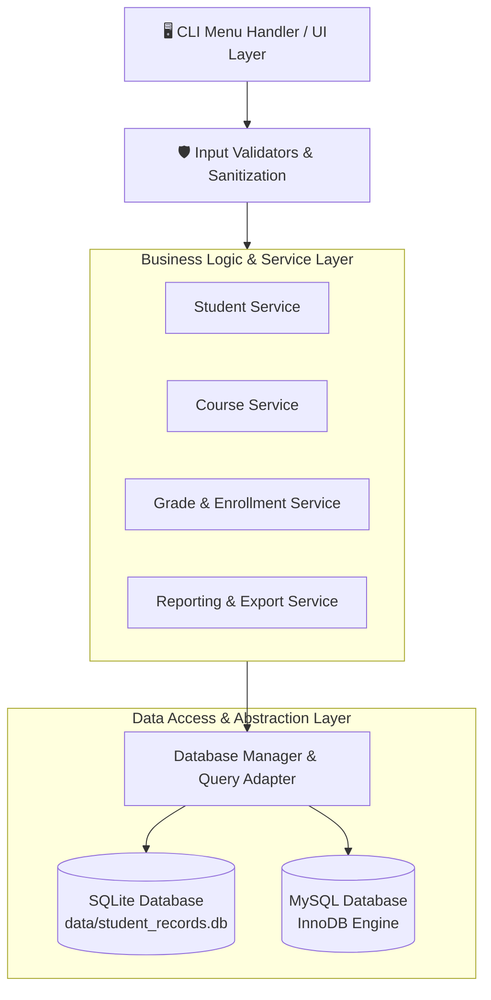
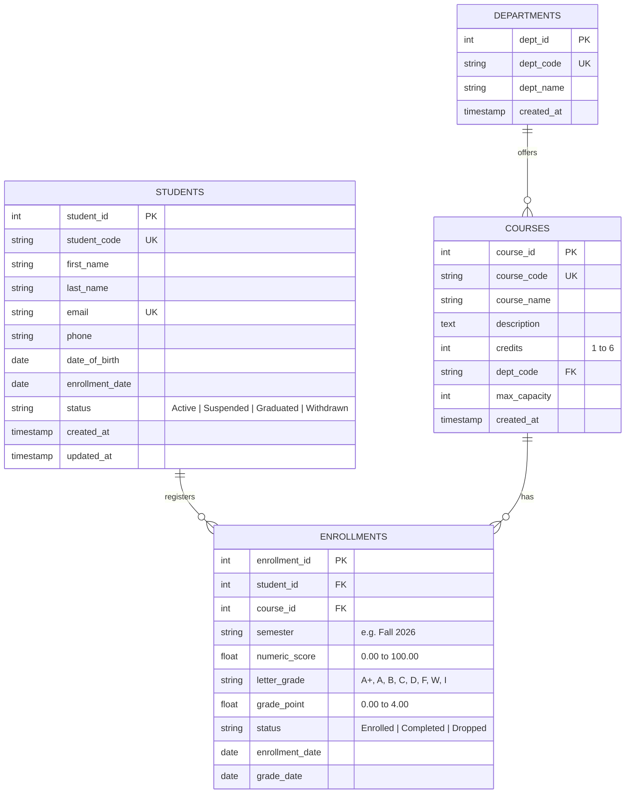

# 🎓 Student Records Management System (SRMS)

[](https://www.python.org/downloads/)
[](https://www.sqlite.org/)
[](LICENSE)
[](#security--sql-injection-prevention)

A normalized, production-grade **Student Records Management System** built with **Python**, **SQL**, **SQLite**, and **MySQL**. It features an enterprise data model in 3rd Normal Form (3NF), full **CRUD** operations for students, courses, and graded enrollments, strict input validation and transaction controls, and an interactive menu-driven terminal interface.

---

## 🌟 Key Features

* **Complete CRUD Engine**: End-to-end Create, Read, Update, and Delete operations for Student, Course, and Grade/Enrollment entities.
* **SQL Injection Immune**: 100% parameterized queries across all database drivers. No user input is ever concatenated into raw SQL strings.
* **Normalized 3NF Architecture**: Comprehensive relational schema with foreign key constraints, `ON DELETE CASCADE`, unique indexes, and domain check constraints.
* **Dual Database Backend**:
  * **SQLite** (Default): Zero-setup, self-contained serverless storage.
  * **MySQL**: Production-ready InnoDB cluster configuration with seamless driver switching.
* **Input Validation & Business Rules**: RFC-compliant email verification, age limits, date chronologies, course credit hour boundaries (1-6), and automated GPA calculation (4.0 scale).
* **Interactive Menu-Driven CLI**: Styled terminal interface with ASCII borders, status indicators, student transcripts, and reports.
* **Academic Analytics & Data Export**: Dean's Honor Roll calculation, departmental summaries, pass/fail rates, and 1-click export to **CSV** and **JSON**.

---

## 🏗️ Architecture & Component Design



---

## 🗄️ Relational Database Schema (3NF)



---

## 🔒 Security & SQL Injection Prevention

All database interactions use **parameterized placeholders** (`?` for SQLite, translated dynamically to `%s` for MySQL via `DatabaseManager`). User input is passed exclusively as discrete bound parameters:

```python
# SECURE: Safe parameterized query execution
query = """
    SELECT * FROM students 
    WHERE student_code LIKE ? OR email LIKE ?
"""
params = (f"%{search_term}%", f"%{search_term}%")
rows = db.fetch_all(query, params)
```

The system includes automated security integration tests (`tests/test_security.py`) verifying that tautology payloads (`' OR '1'='1`), stacked injection attempts (`'; DROP TABLE students; --`), and union queries are rendered harmless as literal strings.

---

## 🚀 Quick Start Guide

### 1. Requirements
* Python 3.10+
* SQLite (built into Python, no external installation required)
* (Optional) MySQL Server 8.0+ and `pymysql` if running in MySQL mode.

### 2. Installation
Clone the repository and set up your virtual environment:

```bash
# Clone the repository
git clone <repository_url>
cd "Student RC Management"

# (Optional) Install enhanced terminal & MySQL dependencies
pip install -r requirements.txt
```

### 3. Run the Application

#### Option A: 🌐 Interactive Web Dashboard (Recommended)
Double-click `run_web.bat` or run:
```bash
python app.py
```
* Automatically opens in your browser at `http://127.0.0.1:5000`.
* Features real-time search, visual Chart.js graphs, interactive modals, printable transcripts, and 1-click CSV/JSON exports.

#### Option B: 💻 Interactive Terminal CLI
Double-click `run.bat` (and select Option 2) or run:
```bash
python main.py
```

#### Option C: 1-Click Interactive Launcher
Double-click `run.bat` in File Explorer to choose between Web Dashboard, CLI, or Automated Tests!

---

## 💻 CLI Menu Overview

```text
╔═══════════════════════════════════════════════════════════════════════════╗
║                                                                           ║
║            🎓  STUDENT RECORDS MANAGEMENT SYSTEM (SRMS)  🎓               ║
║                                                                           ║
║            Enterprise Edition • Python • SQL • SQLite • MySQL             ║
║                                                                           ║
╚═══════════════════════════════════════════════════════════════════════════╝
  Active Engine: SQLITE | Status: .../data/student_records.db
---------------------------------------------------------------------------
  [1] 🎓  Student Management
  [2] 📚  Course Management
  [3] 📝  Grades & Enrollments
  [4] 📊  Reports & Analytics
  [5] ⚙️  Database & System Utilities
  [0] 🚪  Exit Application
---------------------------------------------------------------------------
```

### Academic Features Walkthrough:
* **Student Transcript**: View full student profile, course history, attempted vs. earned credit hours, and calculated cumulative GPA (4.0 scale).
* **Grade Recording**: Enter percentage scores (e.g. 94.5%) — the system automatically maps to letter grade (`A`) and grade point (`4.00`), updates status to `Completed`, and logs the timestamp.
* **Course Capacity Enforcement**: Enforces `max_capacity` on courses; rejects student enrollment if capacity is reached.
* **Honor Roll (Dean's List)**: Dynamically ranks top students meeting custom GPA thresholds (e.g. cumulative GPA $\ge 3.50$) and minimum credit hours.
* **Exporting**: One-click generation of `students_export.csv`, `grades_export.csv`, and `database_backup.json` inside the `exports/` folder.

---

## 🐬 MySQL Backend Setup

To switch to a MySQL backend:
1. Ensure MySQL is running and create the schema:
   ```bash
   mysql -u root -p < database/schema_mysql.sql
   ```
2. Configure environment variables (or update `config.py`):
   ```bash
   export SRMS_DB_ENGINE="mysql"
   export SRMS_MYSQL_HOST="localhost"
   export SRMS_MYSQL_PORT="3306"
   export SRMS_MYSQL_USER="root"
   export SRMS_MYSQL_PASSWORD="your_password"
   export SRMS_MYSQL_DB="student_records_db"
   ```
3. Run the application:
   ```bash
   python main.py --engine mysql
   ```

---

## 🧪 Running Automated Tests

Run the complete test suite (unit tests, CRUD integration, and SQL injection security):

```bash
python -m unittest discover tests -v
```

Test coverage includes:
* `test_validators.py`: Input format validation, age limits, date ordering, score-to-grade mappings.
* `test_crud.py`: Full CRUD for students, courses, enrollments, transcript GPA calculation, and cascade deletions.
* `test_security.py`: SQL injection attack simulations and parameterization verification.

---

## 📂 Project Directory Structure

```text
Student RC Management/
├── config.py                  # Global application & database settings
├── main.py                    # Application entry point & CLI parser
├── requirements.txt           # Python dependencies (pymysql, tabulate, etc.)
├── README.md                  # Comprehensive documentation
│
├── database/                  # Database management & schemas
│   ├── connection.py          # Unified DB connection & query executor
│   ├── schema_sqlite.sql      # 3NF SQLite schema DDL
│   ├── schema_mysql.sql       # 3NF MySQL schema DDL
│   └── seed_data.py           # Demonstration dataset generator
│
├── models/                    # Data models & entity definitions
│   ├── student.py             # Student domain model
│   ├── course.py              # Course domain model
│   └── enrollment.py          # Enrollment & Grade model
│
├── services/                  # Business logic & operations
│   ├── student_service.py     # Student CRUD & official transcripts
│   ├── course_service.py      # Course management & class rosters
│   ├── grade_service.py       # Enrollment, grading & GPA computations
│   └── report_service.py      # Analytics, Dean's list, CSV/JSON exports
│
├── utils/                     # Helper modules
│   ├── validators.py          # Strict data validation & sanitization
│   └── table_formatter.py     # Pure-Python formatted ASCII table renderer
│
├── cli/                       # Terminal user interface
│   ├── ui.py                  # ANSI styling, colors, prompts
│   └── menu_handler.py        # Menu navigation controllers
│
├── tests/                     # Automated test suites
│   ├── test_validators.py     # Unit tests for validation
│   ├── test_crud.py           # CRUD integration & GPA tests
│   └── test_security.py       # SQL injection defense tests
│
├── data/                      # Local storage directory (SQLite database)
└── exports/                   # Export directory (CSV & JSON backups)
```

---

## 📄 License
This project is open-source under the MIT License.
